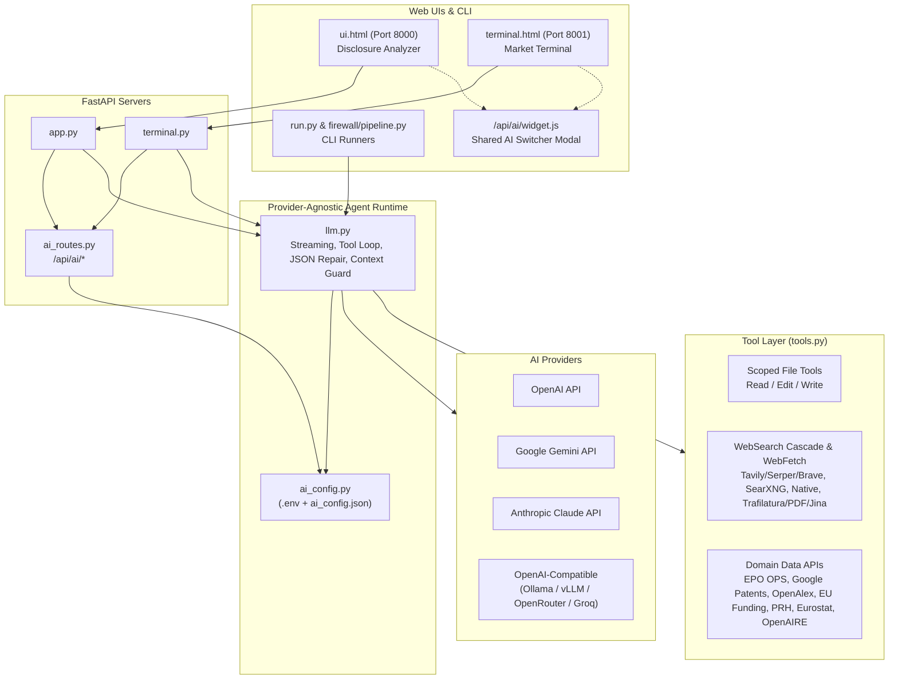

# Innovation Agents (Provider-Agnostic Edition)

An AI-powered platform for analysing invention disclosures (Need, Approach, Benefits per costs, Competition, Technology & IP, Market Intelligence, Funding, and Executive Overview) and exploring sector/patent/research intelligence through a Market Terminal.

Rebuilt from [`Seralathan42/Innovation-agent`](https://github.com/Seralathan42/Innovation-agent) to be **completely provider- and model-agnostic**—removing the `claude_agent_sdk` / Claude subscription lock-in and adding live switching across:

- **OpenAI** (`gpt-4.1`, `gpt-4.1-mini`, `gpt-4o`, `o3`, `o4-mini`, or any model ID)
- **Google Gemini** (`gemini-2.5-pro`, `gemini-2.5-flash`, `gemini-2.0-flash`, etc.)
- **Anthropic Claude** (`claude-sonnet-4-5-20250929`, `claude-opus-4-1-20250805`, `claude-haiku-4-5-20251001`, etc.)
- **OpenAI-Compatible Endpoints** (Ollama, LM Studio, vLLM, OpenRouter, Groq, Together AI, DeepSeek, or any custom `/v1/chat/completions` URL)

---

## Key Features

### 1. Live Provider & Model Switcher (UI + CLI + API)
- Switch providers, models, API keys, and custom OpenAI-compatible endpoints directly from the **AI Provider & Model** pill in both web apps (`http://127.0.0.1:8000` and `http://127.0.0.1:8001`).
- Save multiple named OpenAI-compatible endpoints (Ollama, vLLM, LM Studio, OpenRouter, Groq, SECDATA) for one-click switching.
- Fetch available models directly from `/models` and run one-click connection latency tests (`/api/ai/test`).
- Assign optional **per-task model overrides** (e.g., local Ollama for the Firewall Secure Zone, cloud frontier models for deep IP/research synthesis, fast model for `WebFetch` page distillation).

### 2. Multi-Backend `WebSearch` & Smart `WebFetch`
- **`WebSearch` automatic cascade** (configurable in AI Settings):
  1. Dedicated search APIs (`TAVILY_API_KEY`, `SERPER_API_KEY`, `BRAVE_API_KEY`)
  2. Self-hosted **SearXNG** (`SEARXNG_URL`, e.g., `http://localhost:8080`) for zero-cost private search
  3. **Provider-Native Search Bridge** — automatically routes searches through Gemini Google Search grounding, OpenAI `/v1/responses` (`web_search`), or Claude server-side `web_search` whenever one of those AI keys is configured (even if the main agent runs on Ollama/vLLM)
  4. DuckDuckGo Instant Answer + Wikipedia fallback
- **`WebFetch` pipeline:** Extracts clean Markdown from HTML via `trafilatura`, extracts text from binary `.pdf` URLs via `pypdf`, falls back to Jina Reader (`https://r.jina.ai/...`) for JS-rendered/blocked pages, and supports optional `focus` distillation on long pages.
- **30-minute TTL cache** for repeated web searches and page fetches.

### 3. Domain Data Tools & Research Suites
- **Disclosure Analyzer (`app.py`, port `8000`):** Upload PDF, Markdown, text, or image disclosures; run specialist agents (`nabc`, `ip`, `market`, `funding`); read reports; and chat with an assistant that can edit reports inside that run's folder.
- **Market Terminal (`terminal.py`, port `8001`):** Sector intelligence dashboard (`library/`), EPO patent search & backfill (`patents.py`, `epo.py`), local similarity search, company/person profiles (`profiles.py`), and Aalto missed-opportunity paper analysis (`research.py`).
- **Keyword Firewall (`firewall/pipeline.py`):** Isolates confidential disclosures inside a secure-zone model to produce a sanitized public brief, runs cloud/research agents on the brief only (logging all outbound queries for leaks), and performs final comparison back in the secure zone.

---

## Architecture Overview

See [docs/architecture.md](docs/architecture.md) for the full technical architecture, sequence flows, SQLite schemas, and endpoint reference.



---

## Project Structure

```text
innovation-agent/
├── ai_config.py          # Provider registry, key masking, custom endpoints, role overrides, search config
├── ai_routes.py          # Shared /api/ai/* FastAPI routes & embeddable UI widget (/api/ai/widget.js)
├── llm.py                # Async streaming adapters (OpenAI, Gemini, Claude, OpenAI-compatible), tool loop, JSON repair
├── tools.py              # 12 domain data tools + multi-backend WebSearch + smart WebFetch + sandboxed Read/Edit/Write
├── run.py                # Disclosure analysis orchestrator & CLI (--provider, --model, --base-url, --api-key)
├── app.py                # Disclosure Analyzer FastAPI server (port 8000)
├── ui.html               # Disclosure Analyzer web UI
├── terminal.py           # Market Terminal FastAPI server (port 8001)
├── terminal.html         # Market Terminal web UI
├── library.py            # Sector market intelligence updater (structured output -> memory.md & data.json)
├── profiles.py           # Company & person profile builder (library/profiles.db)
├── research.py           # Aalto ACRIS missed-opportunity paper screener & deep analyzer (library/research.db)
├── patents.py            # EPO patent database builder, FTS5 similarity & faceted search (library/patents.db)
├── epo.py                # European Patent Office OPS 3.2 OAuth client
├── sectors.json          # Sector definitions & EPO CQL queries
├── agents/               # Specialist disclosure agent prompts (nabc, ip, market, funding)
├── firewall/             # Privacy-preserving keyword firewall pipeline & public-brief agents
├── disclosures/          # Sample & uploaded invention disclosures
├── docs/                 # Project notes, data source docs, and architecture.md
├── library/              # Pre-populated sector knowledge files & runtime SQLite databases
├── outputs/              # Disclosure analysis run folders (reports + run_info.txt)
├── tests/                # Unit tests (mocked HTTP transport & FastAPI TestClient)
├── .env.example          # Environment variable template
├── requirements.txt      # Python dependencies
└── .gitignore
```

---

## Quick Start

### 1. Create virtual environment & install dependencies
```bash
python3 -m venv .venv
.venv/bin/pip install -r requirements.txt
```

### 2. Configure API keys (via `.env` or the web UI)
```bash
cp .env.example .env
```
Add any AI provider key (`OPENAI_API_KEY`, `GEMINI_API_KEY`, `ANTHROPIC_API_KEY`, or `OPENAI_COMPAT_BASE_URL`)—or skip `.env` and configure everything directly in the **AI Provider & Model** button in the web UI (saved to `ai_config.json`, which is gitignored).

Optional external data keys:
- `EPO_KEY` / `EPO_SECRET` — free [EPO OPS](https://developers.epo.org) credentials for patent search & backfill
- `ACRIS_API_KEY` — Aalto ACRIS Research API key for the Research tab
- `TAVILY_API_KEY` / `SERPER_API_KEY` / `BRAVE_API_KEY` / `SEARXNG_URL` — dedicated or self-hosted web search (otherwise `WebSearch` automatically uses Gemini/OpenAI/Claude native search if any of those keys is set)

### 3. Start the Web Apps
```bash
# Terminal 1: Disclosure Analyzer (http://127.0.0.1:8000)
.venv/bin/python app.py

# Terminal 2: Market Terminal (http://127.0.0.1:8001)
.venv/bin/python terminal.py
```

---

## Command-Line Usage

Run specialist disclosure agents directly:
```bash
.venv/bin/python run.py disclosures/example.md
.venv/bin/python run.py disclosures/example.md -a nabc market --provider openai --model gpt-4.1
.venv/bin/python run.py disclosures/example.md --provider gemini --model gemini-2.5-flash
.venv/bin/python run.py disclosures/example.md --provider openai_compatible --model qwen2.5:32b --base-url http://localhost:11434/v1
```

Run the Keyword Firewall (e.g., local Ollama secure zone + cloud research zone):
```bash
.venv/bin/python firewall/pipeline.py disclosures/test-leak-detector.pdf \
  --secure-provider openai_compatible --secure-model qwen2.5:32b --secure-base-url http://localhost:11434/v1 \
  --research-provider openai --research-model gpt-4.1
```

---

## Testing

```bash
.venv/bin/python -m py_compile *.py firewall/*.py tests/*.py
.venv/bin/python -m unittest discover -s tests -v
```

> Unit tests verify configuration switching, key masking, scoped file tools, FastAPI routes on both `app.py` and `terminal.py`, SSE streaming adapters across all four providers, structured-output hooks and JSON repair, `WebSearch` cascade/caching, and `WebFetch` SPA fallback using `httpx.MockTransport`.
