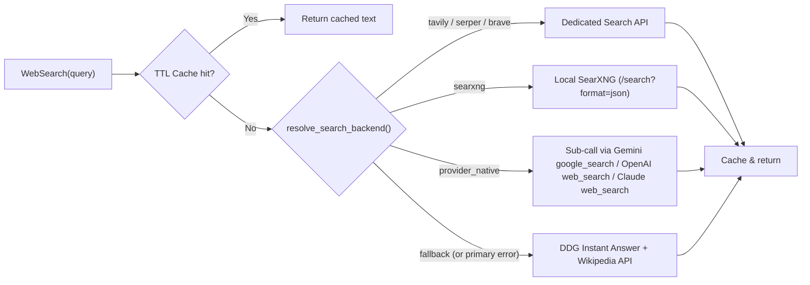
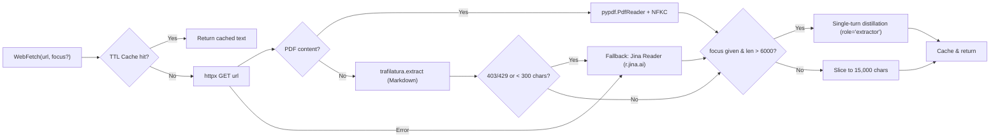

# Application Structure & Architecture

This document describes the internal architecture of the provider-agnostic **Innovation Agents** platform in `/home/saber/innovation-agent`.

---

## 1. High-Level Layered Architecture

The codebase is organized into five clean layers:

1. **Presentation Layer (`ui.html`, `terminal.html`, `/api/ai/widget.js`)**
   - Single-file vanilla HTML/CSS/JS interfaces with streaming NDJSON consumers and live Markdown rendering (`marked` + `DOMPurify`).
   - Both UIs mount the shared widget from `ai_routes.py` (`GET /api/ai/widget.js`), giving consistent provider/model switching, API key management, custom OpenAI-compatible endpoint management, search backend configuration, and connection testing.
2. **Web & API Layer (`app.py`, `terminal.py`, `ai_routes.py`)**
   - Two independent FastAPI servers sharing the `ai_routes.router` (`/api/ai/*`) and persisting shared AI settings in `ai_config.json`.
   - `app.py` (port `8000`) serves disclosure uploads, background multi-agent runs, report viewing, and run-scoped editing chat.
   - `terminal.py` (port `8001`) serves sector dashboards, breaking news, patent & company search, local similarity search, missed-research analysis, entity profiles, and library chat (with `add_sector`).
3. **Provider-Agnostic Agent Runtime (`ai_config.py`, `llm.py`)**
   - `ai_config.py` resolves credentials and active/per-role model settings from `ai_config.json` and `.env`, masks secrets for browser responses, and determines the active `WebSearch` backend.
   - `llm.py` translates a canonical conversation history into wire-format streaming requests for **OpenAI**, **Google Gemini**, **Anthropic Claude**, and **OpenAI-compatible endpoints**, executes multi-turn tool calls, enforces `pre_tool_hook` checks, compacts oversized tool histories, and performs one-shot JSON repair for structured outputs.
4. **Tooling & Data Integration Layer (`tools.py`, `epo.py`)**
   - **Scoped File Tools (`make_file_tools`):** Sandboxed `Read` (Markdown/text/JSON/PDF/images), `Edit`, and `Write` restricted to explicit `read_roots` / `write_roots`.
   - **Web Tools (`WebSearch`, `WebFetch`):** Cascading search backends + `trafilatura`/`pypdf`/Jina Reader extraction + 30-minute TTL cache.
   - **Domain APIs:** Google Patents, EPO OPS (`epo.py`), OpenAlex, EU Funding & Tenders Portal, PRH/YTJ Finnish Trade Register, Eurostat (including PRODCOM & Comext), OpenAIRE, and page image scraping.
5. **Workflow & Storage Layer (`run.py`, `library.py`, `profiles.py`, `research.py`, `patents.py`, `firewall/pipeline.py`)**
   - Markdown files & JSON snapshots in `outputs/` and `library/<sector>/`.
   - SQLite databases (`library/patents.db`, `library/patent_search.db`, `library/profiles.db`, `library/research.db`) using WAL mode and FTS5 full-text indexes.

---

## 2. Core Data Flows

### A. Provider-Agnostic Agent Execution Loop (`llm.py`)

```mermaid
sequenceDiagram
  participant Caller as Caller (run.py / app.py / terminal.py / library.py)
  participant Cfg as ai_config.resolve()
  participant Loop as llm.run_agent_stream()
  participant LLM as Provider Adapter (OpenAI / Gemini / Claude / Compat)
  participant Tools as Tool Layer (tools.py)

  Caller->>Cfg: Resolve provider, model, base_url, api_key (with role override)
  Cfg-->>Caller: Effective endpoint config
  Caller->>Loop: prompt + AgentOptions (tools, output_schema, history, pre_tool_hook)
  loop Until no tool_calls or StructuredOutput accepted (max_turns)
    Loop->>Loop: _compact_history() if total chars > max_context_chars
    Loop->>LLM: Stream chat/messages/generateContent request
    LLM-->>Loop: Text deltas + accumulated tool_calls
    opt pre_tool_hook present (e.g. research.depth_check)
      Loop->>Caller: Check tool allowance / depth rules
    end
    Loop->>Tools: Execute tool_def.fn(args)
    Tools-->>Loop: Text output (+ optional base64 images)
  end
  opt output_schema set & raw text isn't valid JSON
    Loop->>LLM: 1-shot JSON repair pass
  end
  Loop-->>Caller: Final text, structured_output, updated canonical history
```

### B. Multi-Backend `WebSearch` & `WebFetch` Pipeline (`tools.py`)





### C. Disclosure Analyzer (`app.py` + `run.py`)
1. User drops a file in `ui.html` -> `POST /api/runs` saves it in `disclosures/` and launches `run.start_run()`.
2. `run.py` creates `outputs/<timestamp>_<name>/`, initializes `run_info.txt` (recording model, inputs, and per-agent status), and runs independent agents (`nabc`, `ip`, `market`, `funding`) concurrently via `asyncio.gather()`.
3. Any agent with `after: reports` in its frontmatter waits for the first batch and receives those `.md` reports as additional `Read` inputs.
4. `ui.html` polls `/api/runs` every 4 seconds and streams follow-up Q&A and edits via `POST /api/chat` (with `Edit`/`Write` strictly sandboxed to `outputs/<run>/`).

### D. Market Terminal (`terminal.py`)
Starts three background loops on lifespan startup:
1. **`keep_fresh()`** — refreshes stale sector datasets (`library.py`, >3 days old) if a valid AI key is configured.
2. **`patents.keep_pulling()`** — pulls new EP/WO publications every 6h and backfills 5 years of history into `library/patents.db`, rebuilding the indexed search replica `library/patent_search.db` hourly (`os.replace` atomic swap).
3. **`research.keep_up()`** — fetches Aalto papers (2012–2021) from ACRIS into `library/research.db` and screens word overlap against `patents.db` locally.

### E. Keyword Firewall (`firewall/pipeline.py`)
1. **Secure Zone (`role="firewall_secure"`):** Reads disclosure locally (`pypdf`/text), outputs `public_brief.json` + `secret_terms.json` with zero tools.
2. **Local Leak Check & Human Review:** Flags secret terms, numbers, and 6-word n-gram overlaps in `leak_check.txt` and pauses for human review.
3. **Research Zone (`role="firewall_research"`):** Runs `patents`, `market`, and `funding` agents with **no file access** (`allow_read=False`) on the public brief only; logs every tool query to `outbound_log.md`.
4. **Secure Zone Assessment:** Compares the original disclosure with the three public-brief reports to write `assessment.md`.

---

## 3. Configuration & Security Boundaries

| Concern | Mechanism |
|---|---|
| **API Keys & Secrets** | Stored in `.env` or `ai_config.json` (both gitignored). `ai_config.public_config()` returns masked previews (`sk-p...8a2f`) to the browser and never returns raw secrets. |
| **Disclosure Chat Writes** | `app.py` restricts `Edit`/`Write` `write_roots` to `[outputs/<run>]` and `read_roots` to `[outputs/<run>, disclosures]`. |
| **Terminal Chat Reads** | `terminal.py` restricts `Read` `read_roots` to `[library]`, with `allow_write=False`. |
| **Library / Profile / Research Agents** | `allow_read=False`, `allow_write=False` (network data tools only). |
| **Per-Task Model Routing** | `ai_config.resolve(role=...)` supports independent provider/model/base_url overrides for `disclosure`, `chat`, `library`, `profiles`, `research`, `summary`, `extractor`, `firewall_secure`, and `firewall_research`. |

---

## 4. HTTP Endpoints Reference

### Shared AI Endpoints (`ai_routes.py`, mounted on both `app.py` and `terminal.py`)
- `GET /api/ai/config` — Active provider/model, masked key statuses, search backend status, custom endpoints, role overrides.
- `POST /api/ai/config` — Persist updates to `ai_config.json`.
- `POST /api/ai/models` — Live-query `/models` for OpenAI, Gemini, Claude, or any OpenAI-compatible endpoint.
- `POST /api/ai/test` — Run a minimal connectivity check and measure latency.
- `GET /api/ai/widget.js` — Embeddable UI pill and modal script.

### Disclosure Analyzer (`app.py`, port `8000`)
- `GET /` — Serves `ui.html`.
- `GET /api/runs` — Lists runs and `run_info.txt` status.
- `POST /api/runs?name=...` — Saves uploaded disclosure and starts agent run.
- `GET /api/runs/{run}/{name}` — Reads a generated Markdown report.
- `POST /api/chat` — NDJSON streaming chat with run-scoped editing.
- `POST /api/chat/{run}/reset` — Clears chat history for a run.

### Market Terminal (`terminal.py`, port `8001`)
- `GET /` — Serves `terminal.html`.
- `GET /api/sectors`, `GET /api/sectors/{id}/memory`, `POST /api/sectors/{id}/refresh`
- `POST /api/patents/search`, `POST /api/patents/similar`, `POST /api/patents/summary`
- `POST /api/companies/search`
- `POST /api/research/search`, `GET /api/research/{id}`, `POST /api/research/{id}/analyse`
- `GET /api/profile`, `POST /api/profile`
- `POST /api/chat` — NDJSON streaming terminal chat (with `add_sector` tool).
